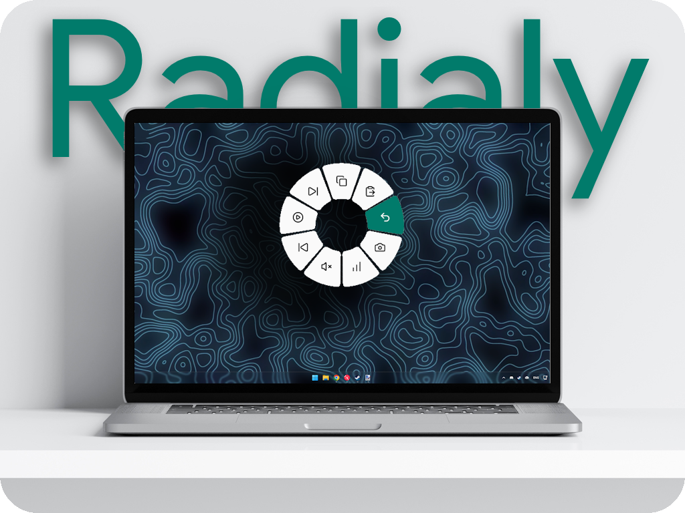

[🔗 Download the latest stable version](https://github.com/LifelessShirt/Radialy/releases/latest)

Radialy is a customizable radial menu for Windows that puts your favorite actions right under your cursor. Assign it to any keyboard key: hold the key to open the menu, point to an option, and release to run it.

## Why Radialy?

- **Use any key as your trigger.** Choose the keyboard key that works best for you, then open the menu with a quick press-and-hold. Mouse buttons can also be assigned.
- **Turn repetitive tasks into macros.** Combine keyboard shortcuts, text input, app or link launches, media controls, pauses, mouse clicks, and scrolling into a single menu item.
- **Make it your own.** Set up menu items and their icons in the app, and customize the menu's appearance.
- **Adapt menus to your workflow.** Create a separate menu for a specific app, while keeping a default menu for everything else.
- **Repeat actions when needed.** Enable repeat for any item and set its interval; select the item to start or stop repeating.
- **Stay out of your way.** Radialy minimizes to the system tray when its window is closed. Settings and logs are stored in `%APPDATA%\Radialy`.

## Get started

1. Open **General → Assign key**, then press the keyboard key you want to use. You can choose the interface language in the same section. On first launch, Radialy detects it automatically: Ukrainian for a Ukrainian Windows locale, Russian for a Russian locale, and English for other locales.
2. In the **Menu** tab, add items and configure their actions. Add multiple steps to create a macro.
3. Hold your assigned key, point to an item in the radial menu, and release to run it.

## Notes

- Apps running as administrator do not receive simulated input unless Radialy is also run as administrator.
- Games in exclusive fullscreen mode do not display the overlay; use borderless windowed mode instead.

## Build from source

Requires Windows 10/11 x64 and [Node.js 20+](https://nodejs.org). Run `npm install`, then `npm run dist`; the installer will be created in `release`.
